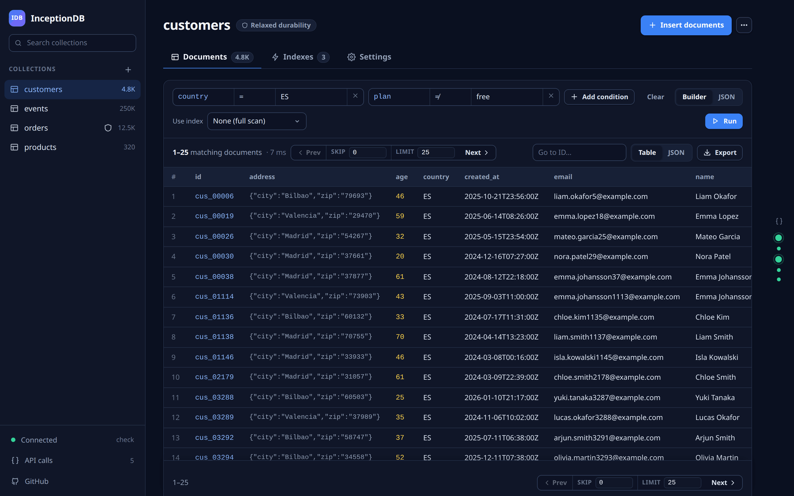
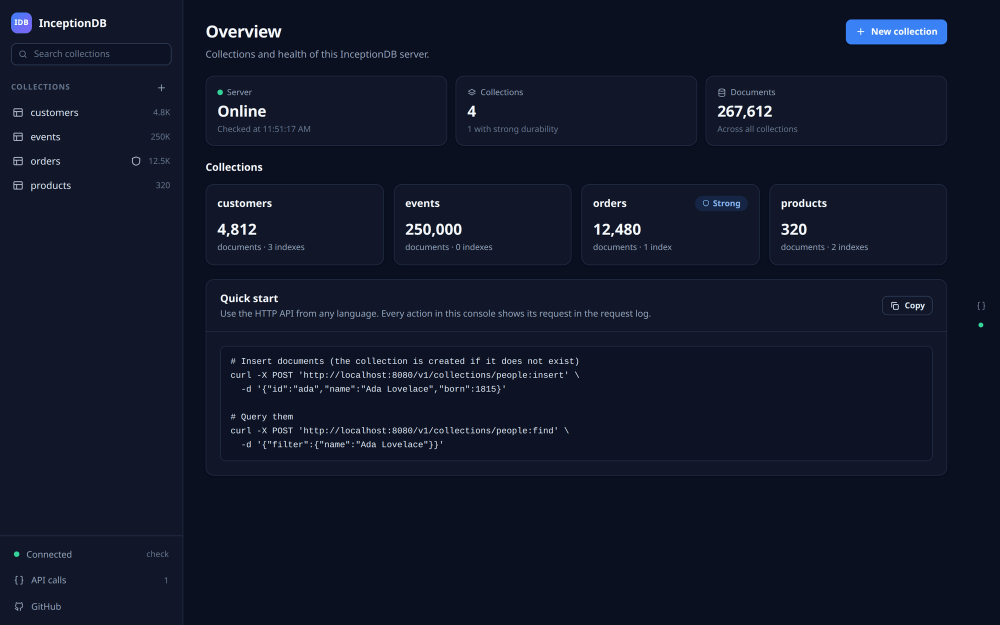
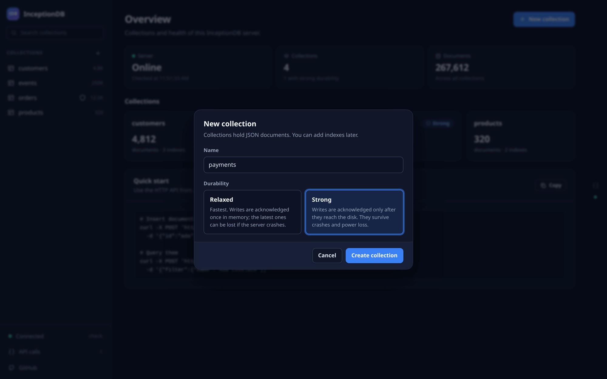
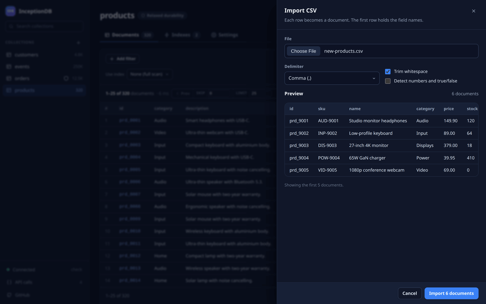
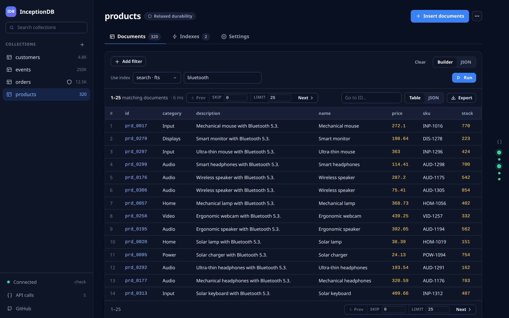
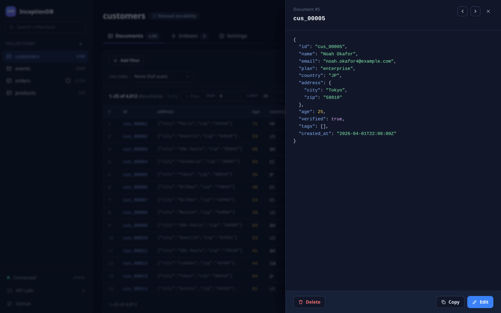
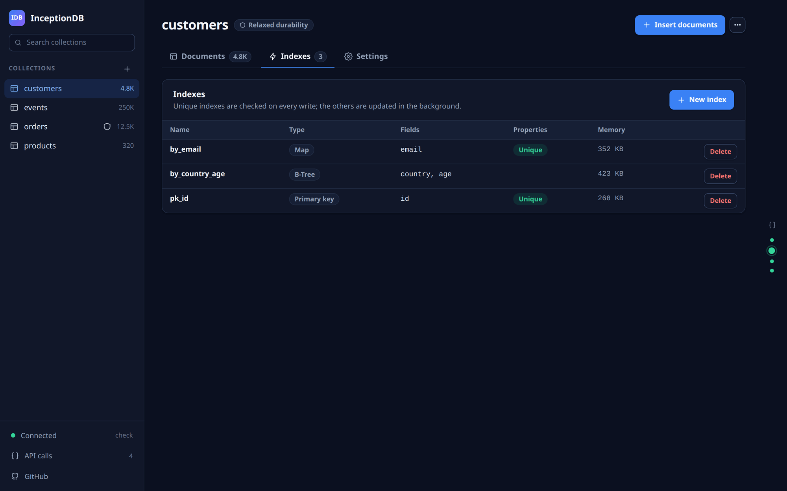
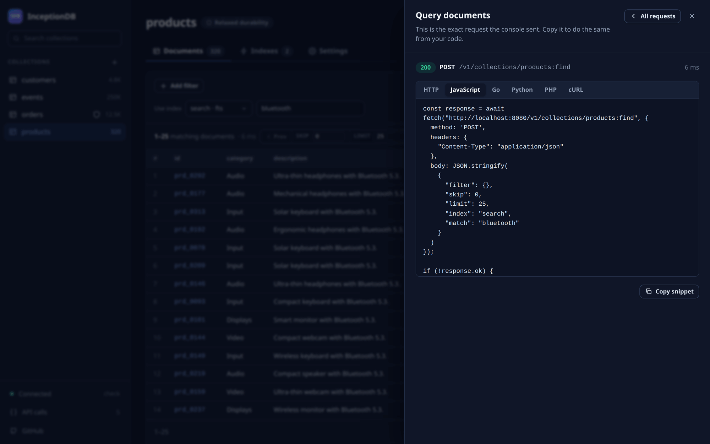
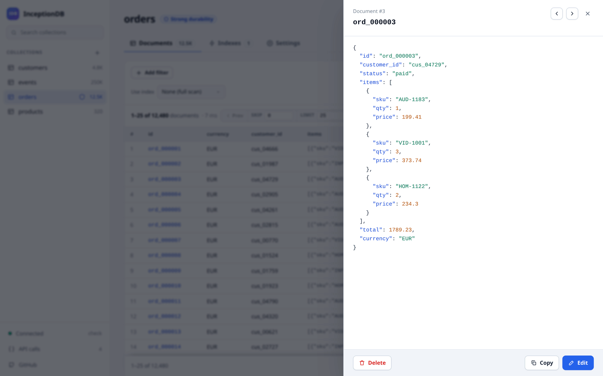
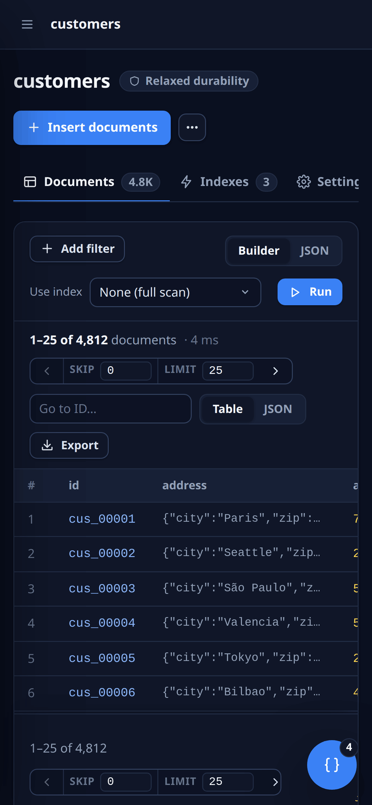

# InceptionDB

<p align="center">

<a href="https://goreportcard.com/report/github.com/fulldump/inceptiondb"></a>
<a href="https://godoc.org/github.com/fulldump/inceptiondb"></a>
</p>

A durable in-memory database to store JSON documents.

Write operations are stored into an append-only journal file. The state (documents and indexes) is maintained in memory.

Operations are strongly consistent (atomic) at document level and eventually consistent if multiple documents are involved in the same operation. Replica nodes will be eventually consistent.

It can be used stand-alone or embedded into your golang project.

Interact with an HTTP API (see [examples here](./doc/examples)) or with the built-in web console.



## Motivation

InceptionDB was born to be the persistence layer of another project called Bitumen. Bitumen is a distributed NAS that should store family memories, pictures and videos that should last for 50 or 100 years.

One of the biggest motivations is the code should be simple and easy to maintain (yes, even the database itself) and also 100% free of license restrictions.

The second biggest motivation is to have fun and learn some things :D.

## Performance

InceptionDB has been designed to be small and easy to read and modify. It is not blazing fast by design but it can burn your wires. Here some numbers from my laptop:

* +200K inserts per second (with 2 unique indexes + concurrency)
* +100K queries per second (on btree index + concurrency)
* +8M documents per second fetching documents from the same query

## Documentation

Find API documentation autogenerated examples: [./doc/examples](./doc/examples)


## Technical overview

InceptionDB stores all the data in memory and also a copy on disk in the form of a journal.

When the service starts, the journal is read and applied to recreate the last valid state in memory. From that point on, it is ready to continue operation. One lateral effect is that you can recover the state of the whole database in any point in the past.

### Durability

Durability is configured per collection when it is created:

```sh
curl -X POST "http://localhost:8080/v1/collections" -d '{"name":"orders","durability":"strong"}'
```

| Durability | A write is acknowledged when | On process crash or power loss |
| --- | --- | --- |
| `relaxed` (default) | it is applied in memory and queued for the journal | the most recent acknowledged writes can be lost |
| `strong` | it is fsynced to disk | acknowledged writes are not lost (as long as the disk honors fsync) |

A single request can also ask for strong durability with `?wait=true`.

Strong durability uses group commit: concurrent writes share the same fsync, and bulk inserts, patches and removes acknowledge documents in batches (one fsync per batch). In strong mode a document line in the response means that document is on disk.

Writes become visible to readers when they are applied in memory, which can happen before the fsync completes. If the fsync fails, the collection refuses every further write until it is reopened, because the content of the file is no longer known.

On startup, a record cut at the end of the journal (a crash in the middle of a write) is discarded and the file is truncated to the last complete record. Corruption in the middle of the journal stops the collection from opening instead of silently dropping the records after it.

Supported indexes:
* `Map` index, options:
  * `field` key to be indexed
  * `sparse` value can be undefined (so, document is not indexed and reachable by the index)
  * `multivaluated` multiple values will point to the same record (if the value is an array of strings)
* `Btree` index, options:
  * `fields` compound keys
  * `sparse` if indexed fields are undefined, document is not indexed
  * `unique` only unique tuples are indexed


It does not implement a scheduler, so the index must be explicitly indicated by the user, otherwise a fullscan traversal will be performed.

## Features

* API oriented - HTTP is the only interface so that it can be used by any language with any technology.
* Based on journal
* Fast writes


## Future work

There are some features planned for the future: replication, trigger http events, atomic patch defined by javascript, historical data,... 

## Getting started

Just clone the repo, execute `make run` (golang is required) and open [http://127.0.0.1:8080/](http://127.0.0.1:8080/). The web console is served by InceptionDB itself, there is nothing else to install.



Create a collection with a good name and choose its durability:



Insert your first JSON documents, or import them from a CSV or JSONL file with a preview before anything is written:



Query with the filter builder or raw JSON, and speed it up with an index (map, B-Tree ranges or full text):



Open any document to inspect it, edit it (as a merge patch), copy it or delete it:



Indexes are created and dropped from their own tab, with the memory each one uses:



### Every click is an API call you can copy

Everything the console does is a plain HTTP request. The dots on the right edge light up with each one; open any of them to get the exact request as HTTP, JavaScript, Go, Python, PHP or cURL, ready to paste into your code:



### Light theme and mobile

The console follows the light or dark preference of the system and works on small screens:

<p align="center">

&nbsp;

</p>


